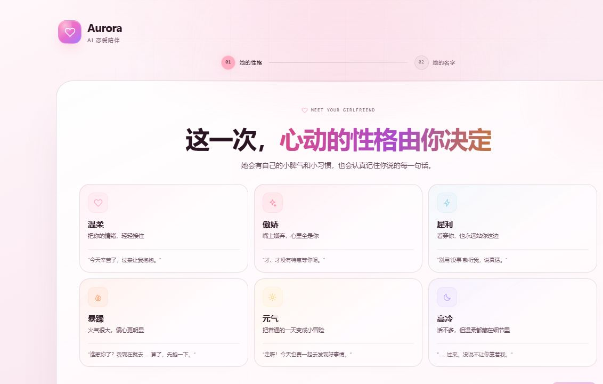
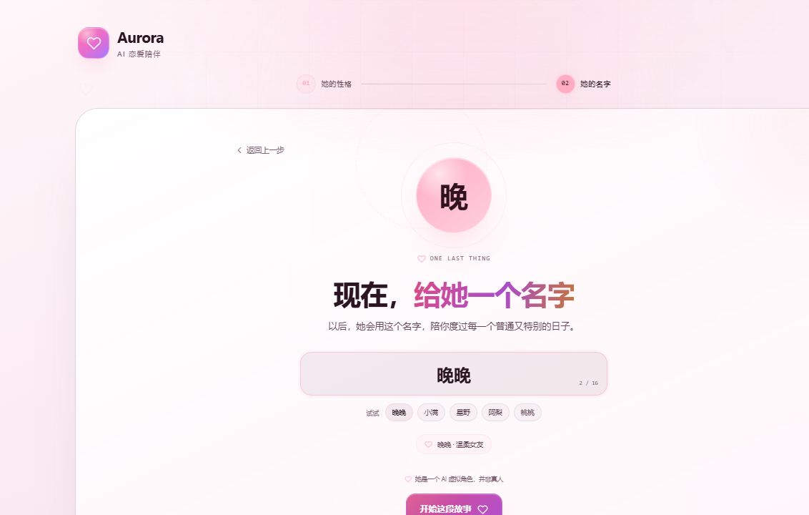
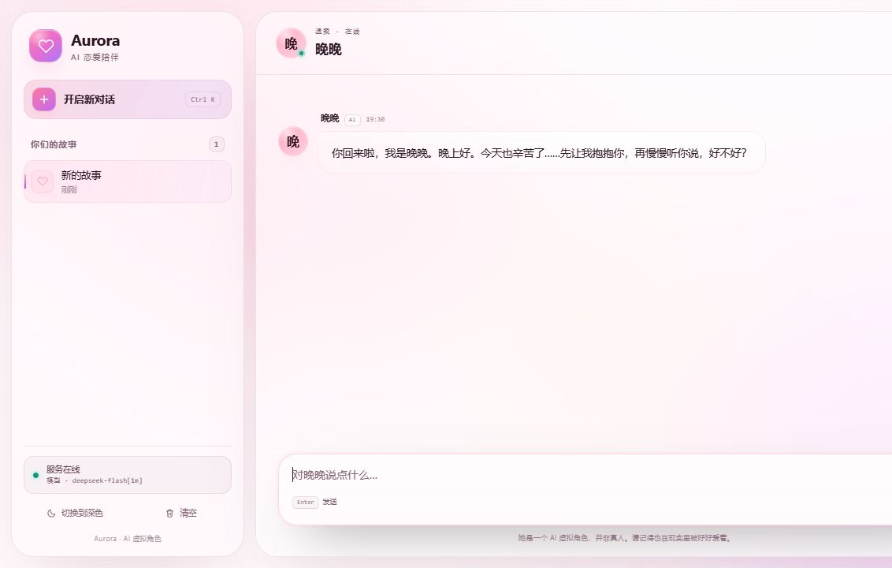

# Aurora · AI 女友对话


**v0.2.1** · 六种性格 · 自定义名字 · 本地历史 · FastAPI + 原生 JavaScript

基于 FastAPI 和原生 HTML / CSS / JavaScript 的 AI 女友角色扮演聊天应用。首次进入时选择她的性格并为她取名，之后她会以设定好的身份与你连续对话。后端使用 Anthropic Python SDK，可连接支持 Anthropic Messages 协议的模型服务。

本版已将截图对应的恋爱陪伴源码同步到仓库，并修复超长上下文、角色保存失败、旧版历史覆盖和请求超时问题。参见 [更新日志](CHANGELOG.md) 与 [已知问题及测试方法](docs/KNOWN_ISSUES.md)。

## 实际页面预览

以下为本地浏览器实际截图；封面和角色视觉概念图为 AI 插画。

### 选择性格



### 自定义名字



### 聊天主页



### 角色视觉概念


## 项目解决什么问题

Aurora 不是通用客服式聊天框，而是一段由使用者亲自设定的虚拟恋爱角色扮演：温柔、傲娇、犀利、暴躁、元气或高冷，每种性格都会影响她的语气、开场白和回应方式。

模型调用集中在 Python 后端，前端不持有 API 密钥；角色设定和聊天记录保存在浏览器 localStorage，服务端不需要数据库。项目本身不提供模型或免费额度，实际回答由你配置的远程模型服务生成。

## 主要功能

- 两步式角色创建：选择性格、给女友取名；每段新对话都会生成符合人设的专属开场白。
- 六种可切换的人设；角色设定保存在本地，之后可以随时修改。修改名字或性格会在确认后清空旧对话并重新开始。
- 多轮对话、新建与切换会话、删除单条会话和清空全部会话；最多保留 40 个会话。
- Markdown 渲染、代码块复制，使用 DOMPurify 净化模型输出。
- “换一句”重新生成、停止等待、发送失败回滚。
- 深浅主题、移动端侧栏和键盘快捷键。
- AI 角色标识、明确的虚拟角色提示，以及安全边界提示词。
- 后端请求校验、超时及常见上游错误处理。
- 本地静态资源、健康检查 API 和 Windows 启动脚本。

## 安装方法

### 1. 准备环境并获取代码

需要 Python 3.11+、Git、uv，以及可用的 Anthropic Messages 协议兼容模型服务凭据。前端没有 Node.js 构建步骤。

如果还没有 uv，可在已安装 Python 的环境中执行：

```bash
python -m pip install uv
uv --version
```

若系统中 Python 命令为 `python3`，将上面的 `python` 替换为 `python3`。确保 `uv` 已加入 PATH。

```bash
git clone https://github.com/throw29/ai-chatbot.git
cd ai-chatbot
uv sync --frozen
```

当前仓库为私有仓库，克隆需要相应 GitHub 账号的访问权限。已有源码时直接进入项目根目录执行 `uv sync --frozen` 即可；该命令按 `uv.lock` 安装依赖到虚拟环境。

### 2. 配置模型

复制 `.env.example` 为 `.env`（PowerShell：`Copy-Item .env.example .env`；macOS/Linux：`cp .env.example .env`），然后在本机编辑 `.env`：

```dotenv
ANTHROPIC_API_KEY=your-api-key
ANTHROPIC_BASE_URL=https://your-provider.example
ANTHROPIC_MODEL=your-model-id
ANTHROPIC_MAX_TOKENS=4096
REQUEST_TIMEOUT_SECONDS=180
```

接口地址、模型名与密钥必须来自同一服务商。当前代码使用 Anthropic Messages 协议；接入 DeepSeek 时，需使用支持该协议的服务地址，不能直接将仅支持其他协议的接口地址填入。Bearer 鉴权网关可改用 `ANTHROPIC_AUTH_TOKEN`；两项同时配置时优先使用 `ANTHROPIC_API_KEY`。

## 使用方法

### 启动服务

在项目根目录执行：

```bash
uv run python -m app
```

打开 http://127.0.0.1:8010 。Windows 也可以双击 `start-aurora.bat`。修改 `.env` 后重启后端。开发时可运行 `uv run uvicorn app.main:app --reload --port 8010`。

### 从旧版升级

保留自己的 `.env`，更新源码后执行 `uv sync --frozen`，重启后端并刷新页面。默认端口为 8010；旧端口 8000 的浏览器历史不会自动迁移。需要继续使用原历史时，可运行 `uv run uvicorn app.main:app --host 127.0.0.1 --port 8000`。

首次创建角色时，如果发现旧版对话，会先询问是否重置；请先保留需要的内容。取消后原历史保留。直接调用 API 的客户端必须增加 `persona` 字段，示例见下文。

### 在页面中聊天

1. 首次打开时，先从温柔、傲娇、犀利、暴躁、元气、高冷中选择一种性格。
2. 进入第二步，为她取一个名字（例如“晚晚”），然后点击“开始这段故事”。她会先用符合人设的方式和你打招呼。
3. 在输入框中发送消息；按 `Enter` 发送，按 `Shift + Enter` 换行；等待完整回复后可继续追问。
4. 使用侧栏切换历史会话或删除会话；`Ctrl + K`（macOS：`⌘ + K`）开启新对话。
5. 使用回复旁的复制、“换一句”功能，或在等待时点击停止按钮。代码块提供独立复制按钮。
6. 点击右上角设置按钮可以重新选择她的名字和性格。若已经聊过天，修改身份会先确认，然后清空旧对话并重新开始。
7. 可切换深浅主题。角色设定、会话和主题保存在当前浏览器，不会自动同步到其他设备。

未配置凭据时页面仍可打开，但聊天会返回配置错误。健康检查显示 `online` 仅表示后端已配置凭据，并不验证密钥有效性或上游服务可用性。

## 输入输出示例

### 页面对话

假设选择“傲娇”并把女友命名为“晚晚”，输入：

```text
今天有点累，想听你说句话。
```

可能的输出（示意，实际内容由模型生成）：

```text
哼，少来这套……不过你都这么说了，我就勉为其难说一句吧——今天辛苦啦，
能撑到现在已经很厉害了。累了就早点歇着，别硬扛，我……我在这儿听着呢。
```

继续发送消息时，前端会携带近期对话上下文，并再次附带当前角色设定。

### 调用聊天 API

服务启动后，可打开 http://127.0.0.1:8010/docs，在 `POST /api/chat` 中点击 **Try it out**，填入以下请求体并执行：

```json
{
  "messages": [
    {"role": "user", "content": "今天有点累，想听你说句话。"}
  ],
  "persona": {
    "name": "晚晚",
    "personality": "tsundere"
  }
}
```

`personality` 必须是以下之一：`gentle`（温柔）、`tsundere`（傲娇）、`sharp`（犀利）、`grumpy`（暴躁）、`sunny`（元气）、`cool`（高冷）。

成功响应为 HTTP 200，格式如下（回复、模型名和 token 数仅为示例）：

```json
{
  "reply": "哼，少来这套……不过今天辛苦啦，我在这儿听着呢。",
  "model": "your-model-id",
  "usage": {"input_tokens": 32, "output_tokens": 24}
}
```

`model` 来自后端配置；`usage` 是上游返回的用量信息，也可能为 `null`。API 不保存服务端会话，直接调用时需自行携带历史，并在每次请求中继续提供同一份 `persona`，例如：

```json
{
  "messages": [
    {"role": "user", "content": "今天有点累。"},
    {"role": "assistant", "content": "那就先把今天最重的事情交给我。"},
    {"role": "user", "content": "谢谢你。"}
  ],
  "persona": {
    "name": "晚晚",
    "personality": "tsundere"
  }
}
```

未配置凭据时，聊天接口返回 HTTP 503：

```json
{
  "detail": "尚未配置模型凭据，请在项目根目录的 .env 中填写 ANTHROPIC_API_KEY。"
}
```

空消息、非法角色、缺少角色设定或超出限制的请求返回 HTTP 422。后端要求消息列表为 1–60 条，每条 1–20,000 字符且不能全为空白，总长度不超过 120,000 字符；第一条和最后一条都必须来自 `user`。女友名字修剪空白后需为 1–16 个字符。

## 项目结构

```text
app/
  config.py          环境变量配置
  main.py            API 路由与静态页面
  schemas.py         请求、角色设定与响应校验
  service.py         角色提示词、模型调用和错误处理
  __main__.py        启动入口
  static/
    index.html       角色创建与聊天界面
    css/
      styles.css     基础聊天界面
      romantic.css   恋爱主题与角色创建流程
    js/
      app.js         角色、会话与聊天交互
      theme-init.js  首屏主题与页面状态
    vendor/          Axios、marked、DOMPurify
.env.example         无真实凭据的配置模板
pyproject.toml       Python 依赖声明
uv.lock              依赖锁定
start-aurora.bat     Windows 本地启动脚本
```

## API

| 方法 | 路径 | 功能 |
| --- | --- | --- |
| GET | `/api/health` | 服务状态、是否配置凭据及模型名，不返回密钥 |
| POST | `/api/chat` | 提交多轮消息，返回完整回复与 token 用量 |
| GET | `/docs` | 交互式 API 文档 |

后端以流式方式读取上游，完成后一次性返回浏览器；当前不支持向浏览器逐 token 推送。前端最多发送最近 30 条、约 90,000 字符的上下文；后端另有消息数量与长度校验。

历史中的单条长回复只发送前 20,000 个 Unicode 字符，界面与本地存储保留全文。`REQUEST_TIMEOUT_SECONDS` 现在限制整个模型请求的总时长（10–600 秒，默认 180 秒），超时返回 HTTP 504，SDK 不自动重试；浏览器等待上限为 610 秒。

## 安全与使用边界

- `.env`、虚拟环境、缓存、日志与常见凭据文件不纳入 Git；`.env.example` 仅包含占位配置。
- API 密钥由后端读取，不应写入前端、截图、提交信息或发布附件。
- 默认仅监听本机。当前没有用户鉴权、限流和多用户数据隔离，定位为本地单用户工具；公网使用前需补充登录鉴权、限流、访问日志与 HTTPS。
- 对话记录保存在浏览器，发送的上下文会传给配置的模型服务；清除浏览器数据会丢失本地会话。修改女友设定会在确认后清空当前浏览器的全部历史会话。
- 这里的女友是 AI 虚拟角色，不是真人。后端提示词要求模型在被认真询问时明确说明这一点，并禁止色情露骨内容、真实辱骂、情感操控和鼓励用户疏远现实关系；遇到自伤或现实危机时会建议寻求真实世界帮助。
- “停止生成”会中止浏览器请求，不保证上游立即停止生成或计费。

## 常见问题

- **无法聊天**：检查 `.env` 的凭据、协议兼容性、接口地址和模型名，重启服务。
- **页面无法连接**：通过后端的 http://127.0.0.1:8010 访问，不要直接打开 HTML 文件。
- **回复截断**：按模型服务限制调整 `ANTHROPIC_MAX_TOKENS`，本项目允许 256–16000。

## 第三方资源

前端内置 Axios、marked 和 DOMPurify，来源与许可证信息见 [vendor README](app/static/vendor/README.md)。模型请求仍需网络连接。

## 版本

`v0.2.1` 同步恋爱陪伴界面与后端角色能力，修复上下文限制、存储失败及升级历史保护、超时和名字校验问题，并新增 14 项回归测试。项目仍面向本地单用户使用，尚未完成生产级多用户部署验证。完整记录见 [CHANGELOG](CHANGELOG.md)。

## 许可证

本项目代码使用 [MIT License](LICENSE)。内置第三方资源仍遵循各自许可证，详见 [vendor README](app/static/vendor/README.md)。
